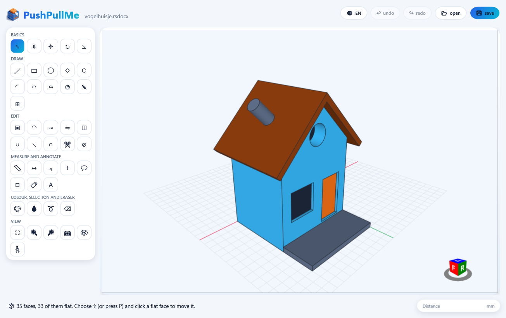
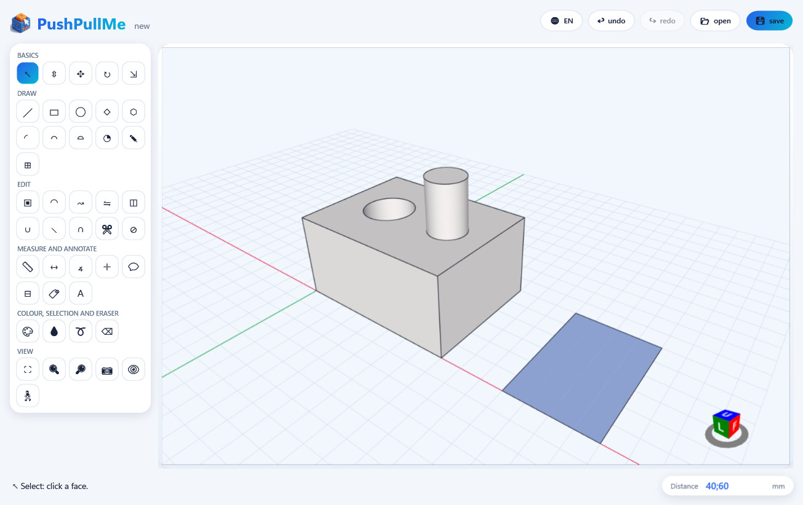
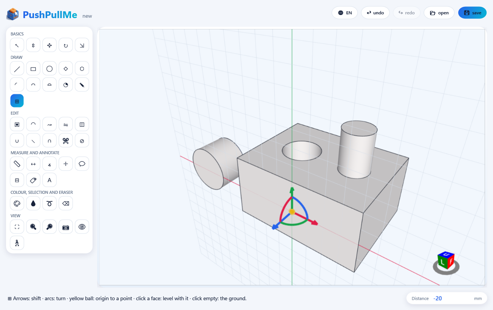
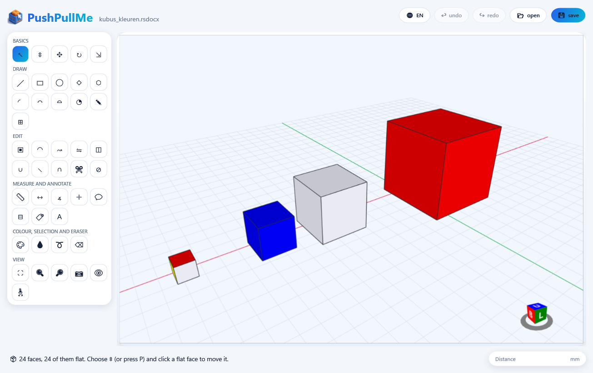

# PushPullMe

[](https://github.com/gj2830/PushPullMe/actions/workflows/build.yml)

*[Nederlands hieronder](#nederlands)*

A playful 3D modelling app in the spirit of SketchUp, with the habits of DesignSpark Mechanical. It works with exact
geometry (planes, cylinders, cones, spheres, tori, free forms), saves as **STEP** (its main format, read by nearly every
CAD program, and opened again from them) and reads and writes DesignSpark files (`.rsdocx`) through
[StlConverter](https://github.com/gj2830/StlConverter), which comes along as a submodule. STL and 3MF can be imported
too. The interface is in English or Dutch; switch with the 🌐 button.



The birdhouse is in [examples/birdhouse.rsdocx](examples/birdhouse.rsdocx): open it in PushPullMe or in DesignSpark Mechanical.

## What it can do

- **Start drawing right away** on an empty work sheet: rectangles, circles and lines on the ground (or on any face)
  become faces; push/pull turns them into blocks and cylinders. Overlapping shapes divide each other, as in other
  modellers.
- **Work plane** (⊞): put it level with a face, or move and turn it with its handle (arrows, arcs, a ball), and draw
  beside the model on it.
- **Push/pull**, also cylinders, roundings and faces without thickness; "level with this face" while dragging.
- **Draw**: lines, rectangles (also rotated), circles, polygons, arcs (2-point, 3-point, from the centre), pies,
  freehand, 3D text, loose lines that close into faces.
- **Edit**: offset, round edges, move, rotate, scale, mirror, Follow Me (round an axis, also a whole turn, or along a
  path), union / subtract / intersect / trim / split (also with round faces), outer shell.
- **Measure and annotate**: tape measure and guides, protractor, dimensions, text labels, axes, section plane, hiding
  parts, paint and the colour picker.
- **Look around**: orbit freely all the way round, pan, zoom to the mouse, zoom window, position camera, look around,
  walk. Drawn with OpenGL.
- **Windows, Linux and macOS**: the window is made with [Avalonia](https://avaloniaui.net); everything the tools do
  lives in a layer of its own (`src/PushPullMe.Editor`), the same on every system.
- Every tool works by dragging (press, drag, release) as well as by click, move, click; distances and angles can be
  typed.







## Download

[Releases](https://github.com/gj2830/PushPullMe/releases) has a ready-to-run package per system; .NET does not need to
be installed separately.

- **Windows** (64-bit): unpack the `win-x64` zip and start `PushPullMe.exe`.
- **Linux** (64-bit): unpack the `linux-x64` tar.gz and start `PushPullMe/PushPullMe`. It needs OpenGL (a desktop with
  a graphics driver has it).
- **macOS**: unpack the zip (`osx-arm64` for Apple silicon, `osx-x64` for Intel) and move `PushPullMe.app` to your
  Applications. It is not signed by Apple: the first time, right-click it and choose **Open** (or run
  `xattr -dr com.apple.quarantine PushPullMe.app`).

## Build it yourself

You need the .NET 10 SDK, on Windows, Linux or macOS.

```
git clone --recursive https://github.com/gj2830/PushPullMe.git
cd PushPullMe
dotnet run --project src/PushPullMe -c Release
```

Cloned without `--recursive`? Fetch the converter with `git submodule update --init`.

Tests: `dotnet test tests/PushPullMe.Tests`.

## Working with an AI assistant (MCP)

PushPullMe can let an AI assistant work along in its window through the
[Model Context Protocol](https://modelcontextprotocol.io): any MCP client (Claude Code, Claude Desktop, VS Code, Cursor,
…) can look at the model and change it: push/pull, draw, move, group, paint, open and save, and take a picture of the
view. It is **off** until you tick **🤖 AI assistant may work along** (bottom right). You see everything it does in the
status bar, and every change can be undone (Ctrl+Z); before opening over unsaved work or overwriting a file it asks you.
To show the model all round, the assistant can turn the camera round it (screenshot with an azimuth and elevation): the
model keeps its size from every side and is not changed.
It only listens on your own computer, to your own user account (a named pipe on Windows, a Unix socket on Linux and
macOS; no network port).

The MCP server is `PushPullMe.Mcp` (`PushPullMe.Mcp.exe` on Windows), next to the app (on macOS in
`PushPullMe.app/Contents/MacOS/`; stdio transport). Tell your client to start it:

- **Claude Code**: in this folder `.mcp.json` already does (after `dotnet build src/PushPullMe.Mcp -c Release`);
  elsewhere `claude mcp add pushpullme -- "/path/to/PushPullMe.Mcp"`.
- **Claude Desktop** (`claude_desktop_config.json`):
  `{"mcpServers": {"pushpullme": {"command": "/path/to/PushPullMe.Mcp"}}}`.
- **VS Code** (`.vscode/mcp.json`):
  `{"servers": {"pushpullme": {"type": "stdio", "command": "/path/to/PushPullMe.Mcp"}}}`.

On Windows the path is like `C:\path\to\PushPullMe.Mcp.exe`, with doubled backslashes inside JSON.

The tools come from the app, not from the server: a rebuilt PushPullMe brings its new or changed tools as soon as it
starts (the server looks every two seconds and tells the client, which fetches them again), without restarting the
server or the client's session. While PushPullMe does not run, the server offers the tools the app last wrote down
(`mcp-tools.json` in the app's own folder: `%LOCALAPPDATA%\PushPullMe` on Windows, `~/.local/share/PushPullMe` on
Linux, `~/Library/Application Support/PushPullMe` on macOS). Only a change to the server itself (`src/PushPullMe.Mcp`) needs it
restarted (in Claude Code: `/mcp`, reconnect); building is fine while it runs, as long as the server did not change.

## Nederlands

Een speels tekenprogramma voor 3D-vormen in de stijl van SketchUp, met de gewoontes van DesignSpark Mechanical. Het
werkt met exacte vormen (vlakken, cilinders, kegels, bollen, ringen) en leest en schrijft DesignSpark-bestanden
(`.rsdocx`) via [StlConverter](https://github.com/gj2830/StlConverter), dat als submodule meekomt. Het hoofdformaat is
**STEP**: dat lezen vrijwel alle CAD-programma's, en STEP uit andere programma's opent PushPullMe ook. Ook STL en 3MF
kunnen worden ingelezen. Het programma is in het Engels en het Nederlands (🌐-knop).

Wat er kan: meteen tekenen op een leeg werkblad (rechthoeken, cirkels en lijnen op de grond worden vlakken, ⇕ maakt er
blokken van; overlappende vormen delen elkaar), een werkvlak (⊞) dat je gelijk legt met een vlak of verschuift en draait
met de greep, duwen/trekken (ook cilinders, afrondingen en vlakken zonder dikte), alle tekengereedschappen van
SketchUp, offset, afronden, verplaatsen, draaien, schalen, spiegelen, Follow Me (rond een as of langs een pad),
verenigen/aftrekken/doorsnede/wegsnijden/splitsen (ook met ronde vlakken), meten, maatlijnen, tekst, doorsnedevlak,
verbergen, verven, vrij draaien, zoomen naar de muis en lopen. Alles werkt met slepen en met klik-beweeg-klik; maten en
hoeken kun je typen. Het draait op Windows, Linux en macOS.

Het vogelhuisje bovenaan staat in [examples/birdhouse.rsdocx](examples/birdhouse.rsdocx); het opent in PushPullMe en in
DesignSpark Mechanical.

**Een AI-assistent laten meewerken (MCP):** vink rechtsonder **🤖 AI-assistent mag meewerken** aan, en laat je
MCP-client (Claude Code, Claude Desktop, VS Code, …) `PushPullMe.Mcp` starten (naast het programma; op Windows
`PushPullMe.Mcp.exe`); zie hierboven. Alles wat de assistent doet zie je in de statusregel en kun je ongedaan maken;
standaard staat het uit.

**Downloaden:** onder [Releases](https://github.com/gj2830/PushPullMe/releases) staat een pakket per systeem: voor
Windows een zip (`PushPullMe.exe` starten), voor Linux een tar.gz (`PushPullMe/PushPullMe` starten), voor macOS een zip
met `PushPullMe.app` (niet door Apple ondertekend: de eerste keer rechtsklikken en **Open** kiezen). **Zelf bouwen:** de
.NET 10 SDK op Windows, Linux of macOS, zie hierboven.

## License / Licentie

[PolyForm Noncommercial 1.0.0](LICENSE): free to use, change and share for any noncommercial purpose, and
contributions are welcome; using it in a commercial product is not allowed. Versions up to and including v0.4 were
released under MIT.

Nederlands: vrij te gebruiken, aan te passen en te delen voor niet-commerciële doelen, en meewerken is welkom; gebruik in
een commercieel product mag niet. Versies tot en met v0.4 zijn onder MIT uitgebracht.
