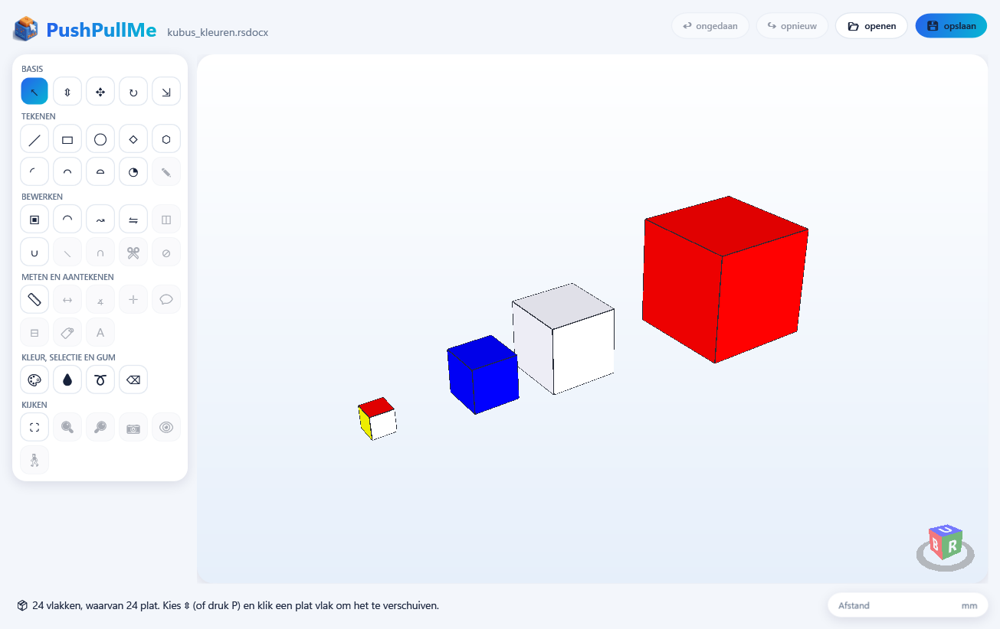
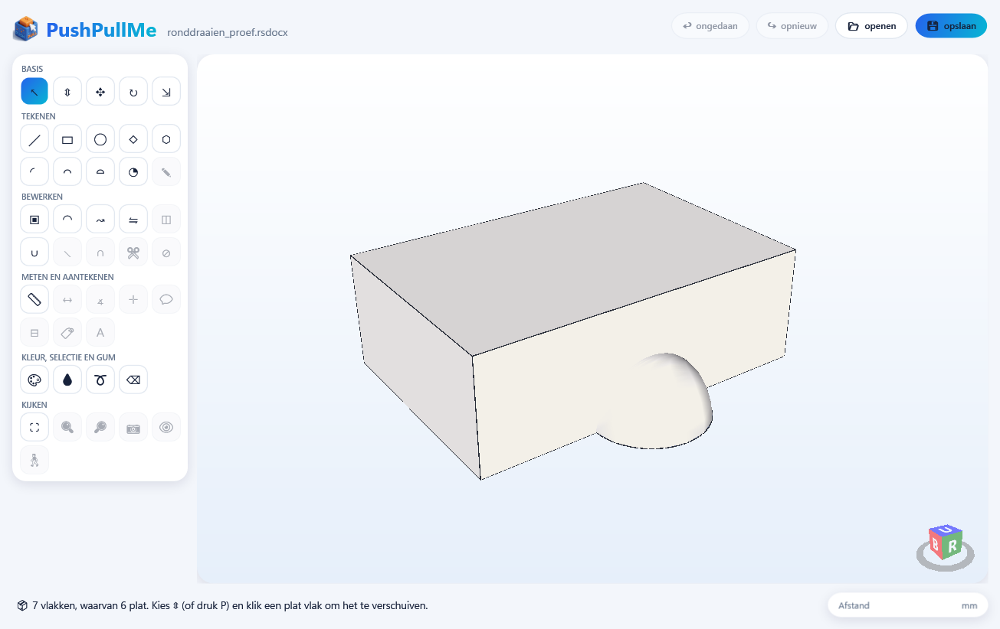

# PushPullMe

[](https://github.com/gj2830/PushPullMe/actions/workflows/build.yml)

Een speels tekenprogramma voor 3D-vormen in de stijl van SketchUp, met de gewoontes van DesignSpark Mechanical. Het
werkt met exacte vormen (vlakken, cilinders, kegels, bollen, ringen) en leest en schrijft DesignSpark-bestanden
(`.rsdocx`) via [StlConverter](https://github.com/gj2830/StlConverter), dat als submodule meekomt. Ook STL en 3MF
kunnen worden ingelezen.



Wat er kan: duwen/trekken (ook cilinders en afrondingen), lijnen, rechthoeken, cirkels, veelhoeken, bogen, taartpunten,
losse lijnen, offset, afronden, verplaatsen, draaien, schalen, spiegelen, ronddraaien (Follow Me), verenigen (platte
vlakken), meetlint en hulplijnen, verf, lasso en gum. Het programma is in het Nederlands.



## Downloaden

Onder [Releases](https://github.com/gj2830/PushPullMe/releases) staat een zip voor Windows (64-bit). Uitpakken en
`PushPullMe.exe` starten; .NET hoeft niet apart geïnstalleerd te zijn.

## Zelf bouwen

Nodig: Windows en de .NET 10 SDK.

```
git clone --recursive https://github.com/gj2830/PushPullMe.git
cd PushPullMe
dotnet build src/PushPullMe -c Release
```

De app staat daarna in `src/PushPullMe/bin/Release/net10.0-windows/PushPullMe.exe`. Al zonder `--recursive`
gekloond? Haal de converter dan op met `git submodule update --init`.

Testen: `dotnet test tests/PushPullMe.Tests`.

## In English

PushPullMe is a playful 3D modelling app in the spirit of SketchUp, with the habits of DesignSpark Mechanical. It
works with exact geometry (planes, cylinders, cones, spheres, tori) and reads and writes DesignSpark files (`.rsdocx`)
through [StlConverter](https://github.com/gj2830/StlConverter); STL and 3MF can be imported too. The app is in Dutch
for now. Download a ready-to-run Windows build from [Releases](https://github.com/gj2830/PushPullMe/releases), or
build it yourself with the .NET 10 SDK as shown above.

## Licentie / License

MIT, zie [LICENSE](LICENSE).
